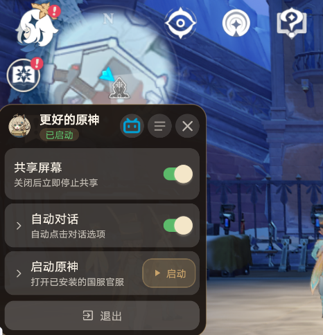

# BetterGI Pocket

更好的原神（BetterGI）的 Android 口袋版。通过悬浮球在游戏上方提供屏幕识别与自动点击，目前主要用于自动对话。

## 功能

- **悬浮球**：授权后以气泡形式显示在其他应用之上，可拖动、展开面板
- **屏幕共享**：捕获游戏画面，用于模板识别（Android 14+ 可选择单个应用）
- **自动对话**：识别剧情对话后自动点击选项；可选「快速点击跳过」以点击屏幕下方继续
- **启动原神**：打开已安装的客户端，可选在未检测到游戏时自动启动一次

支持国服官服、Bilibili 服、国际服、云原神及部分渠道服。

## 使用说明

1. 安装并打开应用，按提示开启**悬浮窗**权限
2. 先在应用设置中找到 更好的原神 进行单次授权
3. 在系统设置中开启无障碍服务「更好的原神」（用于模拟点击、判断原神是否在前台）
4. 点开悬浮球，打开**共享屏幕**，在系统弹窗中选择原神画面
5. 按需打开**自动对话**等开关

清理后台后若提示无障碍异常，关闭后再重新打开该服务即可。

## 详细说明

当前有且仅有自动剧情连点的功能，支持大部分分辨率下的原神、云原神。

注意：无法小窗使用（应该是无障碍不支持）

1. 安装完成后，点击图标后打开，会出现一个悬浮气泡（注意在安装期间请给与悬浮气泡权限）。

2. 启动原神

3. 点击共享屏幕，选择共享整个屏幕（选择共享原神应用也可以）

4. 然后开启自动对话功能

**首次使用时会弹出 无障碍设置 的设置界面，在此处找到 “更好的原神” 并启用**

大概率会弹出下方图中所示的提示：

由于软件未上架任何商店，所以当前 开启 无障碍 必定是 “**受限制的设置**” 状态。这个时候要去设置——应用管理中允许受限制的设置。具体方法看下方👇

## 常见问题

### 遇到“受限制的设置”无法点击？

如果系统提示“受限制的设置”或“出于安全考虑，此设置目前不可用”，请按以下步骤解除限制：

1. **进入应用详情**
    - 返回「设置」主页，点击「应用设置」 → 「应用管理」。

2. **找到目标应用（更好的原神）**
    - 在列表中搜索并点击打开需要授权的那个应用详情页。 

3. **允许受限制的设置**
    - 在应用详情页中，点击右上角的菜单（一般是三个点）或向下滚动，找到并开启 **“允许受限制的设置”**。

4. **重新授权**
    - 返回无障碍页面，即可正常开启该应用的无障碍服务。

### 清理手机后再次启动APP无法进行模拟点击？

相关服务会被系统自动杀死，然后出现如下提示：

这时候只要点进去再重新关闭再启用无障碍即可👇

**重新开关权限**：前往手机的“设置” \> “无障碍”（或无障碍功能），找到对应无法运行无障碍的 更好的原神 应用，**关闭其无障碍授权后重新打开**。
