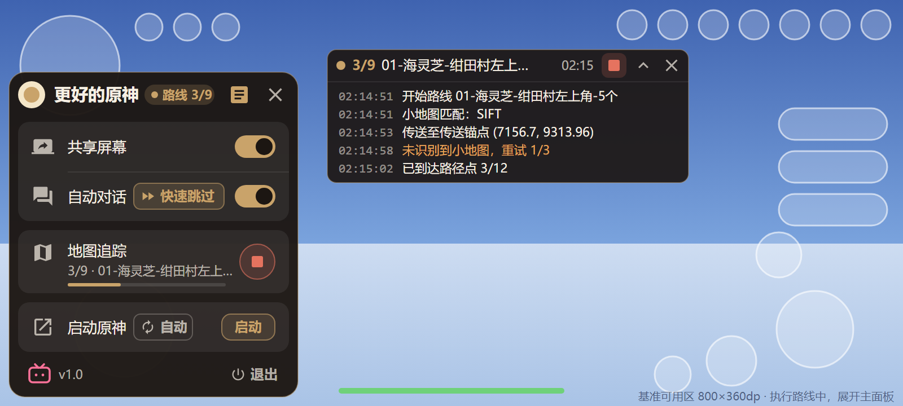
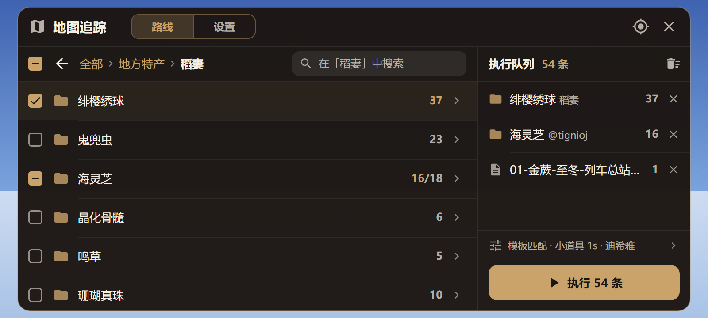
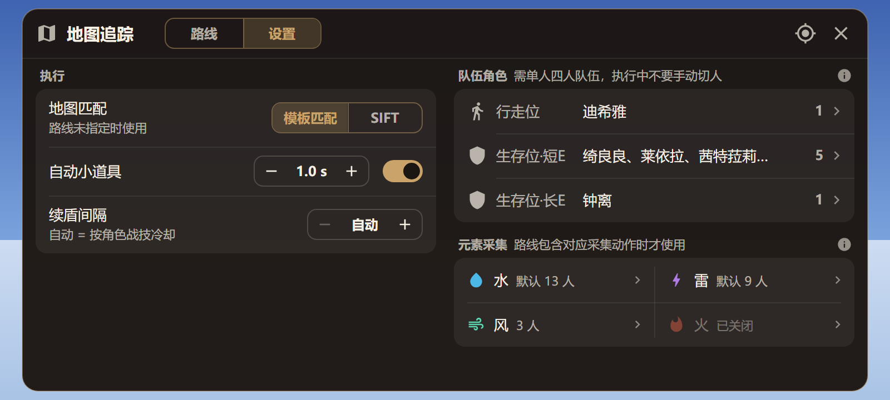
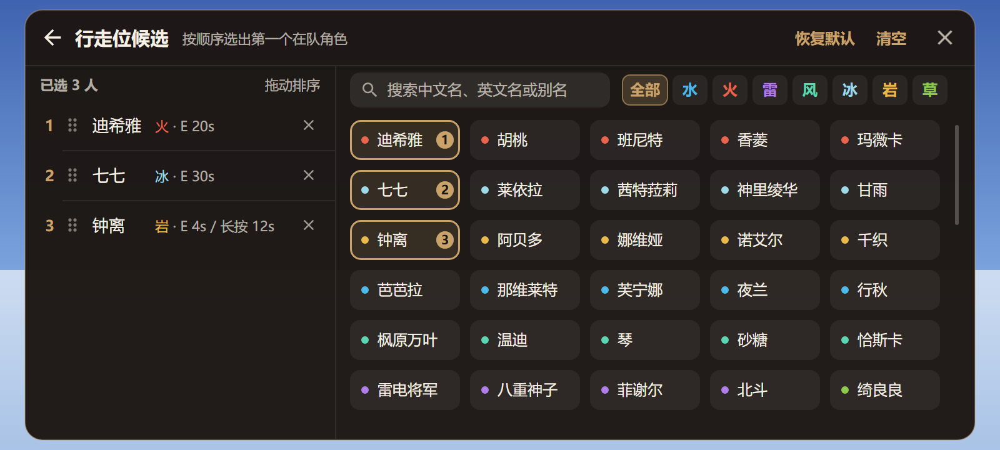

# 悬浮窗 UI/UX 改造设计

状态：已实施（2026-11-07，按第 11 节默认方案落地；验证见 [验证记录](悬浮窗UI改造-验证.md)）

范围：主面板、地图追踪窗口（路线、设置、角色候选）、日志窗口、悬浮窗权限页。

不改：
- 悬浮球本身：图标、状态点、对话角标、拖动吸边、闲置变淡。
- 识别、执行、触控逻辑，以及各项设置的存储格式。界面只新增进度回调和几个只读查询。

草图均按 800×360dp 绘制（横屏手机的常见可用区），源文件和渲染脚本在 `docs/images/ui/`。

## 1. 目标

| 指标 | 现状 | 目标 |
|---|---|---|
| 最小可用区 | 未定义，360dp 高时窗口被裁切 | 横屏 640×320dp 起，所有窗口完整显示，内容超出时可滚动 |
| 地图追踪窗口列表可见行数（800×360dp） | 不到 1 行 | ≥ 5 行 |
| 角色候选一屏可见数（800×360dp） | 不到 1 个 | ≥ 25 个 |
| 再次执行上次选的路线 | 点球 → 开始 → 执行，3 次 | 点球 → ▶，2 次 |
| 执行中停止 | 点球 → 停止，2 次 | 状态条上的停止，1 次 |
| 查看已选路线 | 只能看到数量 | 路线页右栏逐组列出，可单独移除 |
| 字号 / 列表行高种类 | 9 种 / 6 种 | 4 种 / 3 种 |
| 用字符模拟的控件 | □ ☑ ▣ › ▾ ↑ ↓ × ☰ | 无 |
| 设置项需要输入法 | 小道具间隔、续盾间隔 | 无（只有搜索框用输入法） |

## 2. 现状问题

### 2.1 小分辨率下被裁切

1080×2400、density 2.75 的手机横屏可用区约 873×393dp；720p 机型或调大屏幕缩放后是 800×360dp，甚至 320dp 高。以下按 360dp 高计算，数值取自现有布局，单位 dp。

| 窗口 | 计算 | 结果 |
|---|---|---|
| 主面板 | wrap_content，不滚动。收起子项约 300；展开「自动对话」「启动原神」子项约 380 | 展开后超过屏高，底部「启动原神」「退出」被裁掉 |
| 地图追踪窗口 | 高 min(600, 屏高 − 48) = 312。内边距 24、标题 40、页签 48、目录行 40、搜索 44、提示 27、底栏 56，合计 279 | 列表剩 33，不足一行（行高 48）。393dp 高时剩 66，也只有一行 |
| 角色下拉框 | 高 min(440, 屏高 − 48) = 312。内边距 24、标题 40、说明 23、搜索 42、已选标签 54、操作行 36、底栏 44，合计 263 | 列表剩 49，不足一行（行高 58） |
| 日志窗口 | 固定 260×196，默认在左下角 | 占屏高一半，压在摇杆上 |

另外：
- 角色下拉框按锚点上下摆放，和设置窗口错位重叠，下层设置项从下拉框底边露出（`artifacts/ncnn/avatar-multiselect.png`）。
- 窗口尺寸取整块屏幕，没有避开横屏时左右两侧的刘海。

### 2.2 没有统一的对齐和规范

- 主面板同一列标题有三个起点：「共享屏幕」行 10，「地图追踪」行 12，带折叠箭头的行 28（8 + 箭头 14 + 6）（`artifacts/touch-release/panel.png`）。
- 列表行高 36/40/48/56/58/64，按钮高 26/32/36/40，字号 10/11/12/13/14/15/16/18/22sp，圆角 8/10/14/16。
- 同类按钮两种样子：「开始」是文字框，「▶ 启动」带图标。标题栏图标按钮只有 26dp。
- 每行一张独立卡片，行与行之间 4dp 缝隙，界面显得碎。
- 设置页混用三种形态：文字在左的 SwitchCompat、点一下切换的文字行、带 ▾ 的两行多选行。
- 主题继承 Material3 DayNight。系统为浅色模式时，续盾间隔的 AlertDialog 和 CheckBox 是浅色，与深色面板不一致。

### 2.3 用字符代替图标

| 位置 | 现在 | 问题 |
|---|---|---|
| 路线勾选 | □ ☑ ▣，22sp 文字 | 各机型字体渲染不一致；▣ 不是通用的半选样式 |
| 目录名、设置项 | 「名称  ›」「行走位  ▾」 | 箭头拼在文字里，名称长时箭头被截掉 |
| 角色优先级 | ↑ ↓ 文字按钮 | 一次只能移一格 |
| 已选角色 | 「1  迪希雅  ×」 | 序号、名字、删除挤在一段文字里 |
| 日志标题 | ☰ | 像菜单，实际不能点 |
| 文字按钮 | 关闭、取消、清空、上一级、选中本页、清除选择 | 占宽度；「选中本页」含义不清 |

### 2.4 信息量低

- 副标题在复述标题：「关闭后立即停止共享」「自动点击对话选项」「打开已安装的国服官服」。
- 设置页 4 段说明约 260 字，整页约 1000dp 高，大部分来自说明和 64dp 的多选行。
- 每条路线都显示「模板匹配（跟随设置）」。绝大多数路线相同，重复信息挤占了文件名。
- 底栏「已选 9 条路线」和按钮「执行 9 条」重复。
- 执行进度只以自由文本出现在日志里；面板「地图追踪」行显示的是最后一句状态。

### 2.5 路线选择

- 只显示已选数量。跨目录选择后，用户不知道选了什么，也不能单独移除某一组。
- 「全部路线」这段文字可以点，点了回到根目录，界面上没有任何提示。
- 「选中本页」只作用于当前显示的项（搜索时最多 80 项），名称体现不出来。
- 「清除选择」紧挨「执行」，误点即清空，没有撤销。
- 搜索只在当前目录里进行，输入框没有说明范围。
- 目录名「海灵芝@tignioj」里的作者信息没有利用。
- 面板上的「开始」其实是打开窗口；执行中同一个按钮又变成「停止」。
- 切到「设置」页，底栏仍然显示「清除选择 / 执行」（`artifacts/ncnn/avatar-multiselect.png` 底部）。

### 2.6 地图追踪设置

- 地图匹配：点整行文字切换，看不出能点，也看不出一共几个选项。
- 小道具：开关和间隔分两行；间隔需要输入法，为此窗口要临时取得焦点。
- 续盾间隔：弹出系统 AlertDialog，同样需要输入法。
- 角色下拉框是第二个悬浮窗，没有设置 `FLAG_NOT_FOCUSABLE`，打开期间一直占着输入焦点。
- 「显示坐标」是一个操作，却放在设置页，点了还会关闭窗口。
- 队伍识别的前提（单人模式、四人队伍、执行中不能手动换人）只写在 `docs/队伍识别与元素采集.md`，界面上看不到。

### 2.7 执行中

- 运行状态只有日志窗和悬浮球上的状态点。要停止，必须点球展开面板，再点「停止」。
- 日志是绿字配半透明灰底，在加载白屏上对比度很低；日志里的完整相对路径经常折成两行（`artifacts/crash-20261107/route-executing.png`）。
- 日志正文不可触摸，所以不能滚动查看历史。这是为了不挡游戏操作，保留。

### 2.8 代码现状

- `PathingRouteActivity`、`activity_route_picker.xml`、`item_route_node.xml` 是旧的单选路线页，已经没有任何入口。
- 工作区里有未提交的 `ui/SettingRow.kt`、`ui/OverlayGeometry.kt`、`values/ui_attrs.xml`。`SettingRow` 引用的 `bg_ui_row`、`ic_ui_chevron_right` 不存在，当前工作区编译会失败。本设计沿用 `OverlayGeometry` 的思路（4.1 节有一处不同），`SettingRow` 由 4.6 节的行组件替代。
- `PathingRouteWindow` 一个类同时负责窗口、路线浏览、设置页、输入焦点和对话框。

## 3. 设计原则

1. 横屏矮屏优先。按 800×360dp 设计，按 640×320dp 验收下限。平板只放宽窗口，不放大控件。
2. 一屏完成一件事。路线页同时能浏览、看已选、执行；设置和角色候选在同一个窗口里切换，不再叠第二个悬浮窗。
3. 少用输入法。数值用步进器，选项用分段控件，只有搜索弹输入法。
4. 副标题只写状态。功能说明放进长按提示（tooltip）和分组标题旁的说明按钮。
5. 同一种控件只有一种样子；同一列文字只有一个起点。
6. 不挡游戏。执行中只保留状态条；每个可触摸窗口要么纳入触控穿透，要么在执行期间不可见。

## 4. 设计规范

### 4.1 可用区与尺寸档位

可用区 = 显示区域 − 刘海（`displayCutout`，忽略可见性）− 四周 8dp。

不扣状态栏和导航栏。原神全屏沉浸，系统栏平时隐藏；扣掉它们会在 360dp 高的屏上再损失约 24～48dp。工作区里的 `OverlayGeometry` 扣除了系统栏，这里改掉。

窗口每次显示、每次配置变化时，按可用区重新计算尺寸。档位由代码按窗口实际尺寸判断，不用 `layout-w600dp` 这类资源限定符：悬浮窗不是全屏 Activity，服务上下文的 configuration 反映的是整块屏幕。

| 档位 | 条件 | 行为 |
|---|---|---|
| 矮屏 | 可用区高 < 400dp | 窗口高度贴近可用区；分组标题与内容间距 4dp |
| 常规 | 400～600dp | 默认 |
| 平板 | ≥ 600dp | 地图追踪窗口最大 760×560dp，居中 |
| 双栏 | 窗口宽 ≥ 560dp | 路线页、设置页、角色候选页分左右两栏 |
| 单栏 | 窗口宽 < 560dp（竖屏） | 右栏收进底栏或下一级页面 |

### 4.2 间距与尺寸

全部取 4dp 的倍数。

| 名称 | 值 | 用途 |
|---|---|---|
| space xs / s / m / l | 4 / 8 / 12 / 16dp | 间距 |
| inset | 12dp | 行内容左右边距 |
| text_start | 44dp（12 + 图标 20 + 12） | 带前导图标的行，标题从这里开始 |
| row | 44dp | 单行列表、开关行 |
| row_two_line | 52dp | 有副标题的行 |
| row_dense | 40dp | 执行队列、已选角色、元素格 |
| top_bar | 44dp | 窗口标题栏 |
| toolbar | 40dp | 目录、搜索所在的工具行 |
| icon | 20dp；行内 16dp；标签内 14dp | |
| icon_button | 32dp 触控区，内含 20dp 图标 | |
| control | 28dp | 分段控件、步进器、次按钮、筛选标签 |
| primary_button | 40dp | 执行 |
| radius | 窗口 14、分组 10、控件 8、状态胶囊取半高 | |

规则：
- 同一分组的行，要么都有前导图标，要么都没有，保证标题列只有一个起点。
- 行高一律用 minHeight，不写死 height，字体放大时行跟着变高。

### 4.3 字号

| 名称 | 字号 | 字重 | 用途 |
|---|---|---|---|
| title | 15sp | 粗 | 窗口标题、应用名 |
| body | 13sp | 常规 | 行标题、列表名称、输入框 |
| label | 12sp | 中粗 | 按钮、标签、分段、计数 |
| caption | 11sp | 常规 | 副标题、分组标题、日志（等宽） |

悬浮窗的字体缩放上限为 1.3：系统设置超过 1.3 时，悬浮窗上下文按 1.3 处理，避免行被撑高后窗口装不下（见第 11 节待确认）。

### 4.4 颜色

沿用现有深色金色调，收敛为以下 token，放在 `colors.xml`，前缀 `pocket_`。

| token | 值 | 用途 |
|---|---|---|
| surface | #F21C1612 | 窗口背景 |
| surface_group | #12FFFFFF | 分组底色，替代每行一张卡片 |
| outline | #66C9A36A | 窗口描边 |
| divider | #12FFFFFF | 行分隔线，从 text_start 开始画 |
| primary | #C9A36A | 选中、主按钮、开关轨道 |
| on_primary | #1C1612 | 主按钮文字、开关圆点 |
| primary_container | #33C9A36A | 选中的分段和标签底色 |
| text | #F7F0E4 | 正文 |
| text_secondary | #B3F7F0E4 | 副标题、图标 |
| text_disabled | #61F7F0E4 | 不可用 |
| success / warning / error | #5CBA6A / #E8A45A / #E5735F | 状态、日志级别、停止按钮 |
| 元素 | 火 #E8644C、水 #4CB8E8、风 #5CD6B0、雷 #B07CE8、冰 #9CD8E8、岩 #E8B84C、草 #8CC84C | 角色标签、元素采集图标 |

日志不再用荧光绿 #7CFF9A，改用 text / text_secondary 加级别色，背景提到 90% 不透明。

新增悬浮窗专用主题 `Theme.BetterGIPocket.Overlay`，父主题 `Theme.Material3.Dark.NoActionBar`，不随系统深浅色变化。所有悬浮窗的 `ContextThemeWrapper` 改用它。

### 4.5 图标

使用 Material Symbols Rounded 导出的矢量 drawable（Apache-2.0，许可证放进 `assets/licenses/`），24 视口，按 token 着色。纯图标按钮必须设置 `contentDescription` 和 tooltip，长按显示名称。

| 用途 | 图标 | 替换的现状 |
|---|---|---|
| 关闭、收起 | close | 「关闭」「取消」、ic_overlay_close |
| 返回上一级 | arrow_back | 「上一级」 |
| 进入、打开 | chevron_right | 文字里的 › ▾ |
| 勾选三态 | check_box_outline_blank / check_box / indeterminate_check_box | □ ☑ ▣ |
| 搜索、清除输入 | search、cancel | 「清空」 |
| 目录、路线文件 | folder、description | 无 |
| 执行、停止 | play_arrow、stop | 「开始」「停止」「执行 N 条」 |
| 清空队列、撤销 | delete_sweep、undo | 「清除选择」 |
| 拖动排序、移除 | drag_indicator、close（14dp） | ↑ ↓、× |
| 日志 | article | ic_overlay_log、☰ |
| 坐标显示 | my_location | 「显示坐标」 |
| 共享屏幕、自动对话、地图追踪、启动原神 | screen_share、forum、map、open_in_new | 无 |
| 快速跳过、自动启动 | fast_forward、autorenew | 折叠子项 |
| 退出 | power_settings_new | ic_overlay_exit |
| 设置摘要 | tune | 无 |
| 行走位、生存位 | directions_walk、shield | 无 |
| 水、雷、风、火 | water_drop、bolt、air、local_fire_department | 文字 |
| 警告、说明 | warning、info | 无 |
| 步进 | remove、add | 输入框 |

B 站图标保持品牌原色 PNG。

### 4.6 组件

组件放在 `com.bettergi.pocket.ui`，样式放在 `res/values/overlay_styles.xml`。

| 组件 | 规格 |
|---|---|
| 分组 | surface_group 底色、圆角 10；行之间 1dp 分隔线；分组之间 8dp |
| 行 OverlayRow | 前导图标（可选）＋ 标题 ＋ 副标题（有内容才显示）＋ 尾部槽位（开关、按钮、计数加箭头、步进器、分段）。高 44 或 52 |
| 分组标题 | caption 粗体 + 一句短说明；右侧可带 info 按钮，点开在标题下展开完整说明，再点收起 |
| 图标按钮 | 32dp 触控区、20dp 图标、圆形水波纹 |
| 主按钮 | 40dp，primary 实底、on_primary 文字，可带图标；不可用时 12% primary 底、text_disabled 文字 |
| 次按钮 | 28dp，primary 描边、15% primary 底 |
| 文字按钮 | 28dp，无底，primary 文字 |
| 开关 | 统一一个 SwitchCompat 样式：开为 primary 轨道 + on_primary 圆点，关为 12% 白色轨道 |
| 勾选框 | ImageView 加三张矢量图。在 RecyclerView 里直接按数据设图，不依赖 CompoundButton 的状态 |
| 分段 | MaterialButtonToggleGroup，28dp，单选且必选 |
| 步进器 | 「− 值 +」，28dp。长按连续调整；点数值进入数字输入；到边界时对应按钮置灰 |
| 标签 Chip | 24～32dp。选中为 primary_container 底 + primary 描边，按需带勾或序号角标 |
| 计数 | label 字号右对齐。部分选中显示「16/18」，已选部分用 primary |
| 提示条 | 36dp，12% warning 底 + 警告图标 + 一句原因 + 右侧处理按钮（如「去开启」）。只在有问题时出现 |
| 空状态 | 图标 + 一句话 + 可选按钮，居中 |
| 撤销条 | 清空类操作后，在原位置显示 5 秒「已清空 54 条 · 撤销」 |

## 5. 各界面

### 5.1 主面板与状态条

主面板宽 256dp（原 228）。标题栏固定，下方内容可滚动，最大高度 = 可用区高 − 16dp。面板贴着悬浮球所在的一侧展开，顶部与球对齐，越界时向内收。

| 区域 | 内容 | 交互 |
|---|---|---|
| 标题栏 40 | 应用图标、应用名、状态胶囊、日志按钮、收起按钮 | 拖动移动面板；日志开启时日志按钮为金色 |
| 提示条 | 无障碍未连接、屏幕共享被其他应用中断 | 右侧按钮直接处理：打开无障碍设置、重新开启共享 |
| 实时任务 | 共享屏幕、自动对话（含「快速跳过」标签） | 见下 |
| 地图追踪 | 标题、状态副标题、进度条、执行或停止 | 见下 |
| 启动原神 | 标题、「自动」标签、启动按钮 | 见下 |
| 页脚 32 | B 站、版本号、退出 | B 站和退出是低频操作，从标题栏移到页脚；退出放最右，远离常用控件 |

状态胶囊取优先级最高的一项：

| 优先级 | 文字 | 颜色 | 点击 |
|---|---|---|---|
| 1 | 无障碍异常 | warning | 打开无障碍设置（现有行为） |
| 2 | 路线 3/9 | primary | 展开状态条 |
| 3 | 坐标显示中 | primary | 展开状态条 |
| 4 | 对话中 | success | 无 |
| 5 | 共享中 | success | 无 |
| 6 | 未共享 | text_secondary | 无 |

各行：
- 共享屏幕：单行，无副标题。异常由提示条说明。
- 自动对话：「快速跳过」标签替代原来的折叠子项。开启时为金色带图标，关闭时只有描边；长按显示「对话中点击屏幕下方继续」。共享屏幕关闭时开关和标签置灰但仍可点，点了在副标题位置提示「需先开启共享屏幕」，同时让共享屏幕行闪一下。
- 地图追踪：

  | 状态 | 副标题 | 尾部按钮 |
  |---|---|---|
  | 未选择 | 未选择路线 | 执行（置灰，点了打开窗口） |
  | 已选择 | 已选 54 条 · 绯樱绣球 等 3 组 | 执行 |
  | 执行中 | 3/9 · 路线名，下方 3dp 进度条 | 停止（error 色） |
  | 坐标显示中 | X 7156.7  Y 9313.9 | 停止 |
  | 刚结束 | 12:30 完成 7 · 跳过 1 · 失败 1 | 执行 |
  | 启动被拒 | 拒绝原因，如「还没标定：小道具」（warning） | 执行 |

  - 点行：打开地图追踪窗口。执行路线期间不打开，改为展开状态条（原因见 6.3）。
  - 点执行：已有选择时直接开始，不经过窗口；没有选择时打开窗口。
  - 「绯樱绣球 等 3 组」由窗口保存选择时一并写入 `PathingRouteStore`，面板不用加载 5302 条的路线目录。
- 启动原神：副标题平时不显示；未安装时显示「未安装原神」（warning），启动按钮置灰。「自动」标签对应原来的「无原神时自动启动」，长按显示完整说明。启动失败改为副标题提示，不再弹 Toast。

高度：标题栏 40 + 三个分组 188 + 间距 24 + 页脚 32 + 底边 4 = 288；出现提示条时 332。800×360dp 的可用区高 344，可以完整显示；320dp 高（可用区 304）时内容区滚动。

状态条（替代「识别日志」窗口）：
- 结构不变：标题行可触摸，正文不可触摸，游戏操作可以穿过正文。
- 宽 min(320, 可用区宽 × 40%)。默认在顶部居中、顶部图标行下方（距顶 40dp），避开摇杆和技能区；可以拖动并记住位置。已保存的旧位置若仍在可用区内，继续沿用。
- 三种模式：隐藏、精简（只有 28dp 标题行）、展开（标题行加正文）。点标题行文字在精简和展开之间切换；面板标题栏的日志按钮控制显示和隐藏。
- 标题行：

  | 状态 | 内容 | 右侧按钮 |
  |---|---|---|
  | 空闲 | 日志图标 · 最新一条日志 | 展开/收起、隐藏 |
  | 执行路线 | 状态点 · 3/9 · 路线名 · 用时 | 停止、展开/收起、隐藏 |
  | 坐标显示 | 状态点 · 坐标与视角 | 停止、展开/收起、隐藏 |
  | 刚结束 | 完成 7 · 跳过 1 · 失败 1 | 展开/收起、隐藏 |

- 正文：行数随可用区高度变化，矮屏 5 行，平板 10 行；等宽 11sp；时间戳用 text_secondary；警告、错误整行用 warning、error 色。路线日志只写文件名，去掉目录和 `.json`。
- 开始执行时，如果状态条处于隐藏，自动以精简模式出现；用户展开过的保持展开。
- 停止按钮在状态条标题行上，执行中点一次即可停止。标题行窗口已在 `coversStroke` 的检查范围内，注入手势落在上面时会临时穿透。

### 5.2 地图追踪窗口框架

- 尺寸：宽 min(760, 可用区宽)，高 min(560, 可用区高)，居中。800×360dp 下为 760×344。
- 标题栏 44：地图图标、「地图追踪」、分段页签「路线 | 设置」、坐标显示按钮、关闭按钮。
  - 坐标显示：点击后关闭窗口并开始显示坐标，坐标出现在状态条上；显示中图标为金色，再点停止。tooltip 写明「显示坐标（会关闭窗口）」。
  - 进入角色候选页时，标题栏变为「返回 · 页面标题 · 一句说明 …… 恢复默认 · 清空 · 关闭」。
- 页签切换保留各自的滚动位置；关闭后再打开，回到上次的页签和目录。
- 焦点：浏览时保持 `FLAG_NOT_FOCUSABLE`，只在搜索框编辑期间临时取得焦点。沿用现有的 beginInput / finishInput，提取成 `OverlayInput` 供各页共用。角色候选页在同一个窗口内，不再有第二个可聚焦窗口。
- 执行路线期间不允许打开（6.3）。

### 5.3 路线页

左栏：目录浏览。

- 工具行 40：全选框、返回、面包屑、搜索框。
  - 全选框和列表勾选框在同一列，三态反映当前显示的全部项；tooltip「选择列表中显示的 N 项」。它替代「选中本页」。
  - 面包屑每一段都能点，直接跳到该层；太长时省略前面的段，如「… › 稻妻 › 海灵芝」。在根目录时隐藏返回按钮，面包屑只显示「全部路线」。
  - 搜索框的提示文字写明范围：根目录为「搜索路线，支持拼音首字母」，子目录为「在「稻妻」中搜索」。有内容时右侧出现清除按钮。单栏时搜索收成图标，点开后覆盖面包屑。
- 列表行（44，搜索结果 52）：勾选框、目录或路线图标、名称、作者、计数、箭头。
  - 名称单行。路线文件名用中间省略（`01-海灵芝-绀田…-5个`），保留序号和数量；长按显示全名。
  - 目录名「材料@作者」拆成名称和作者两部分，作者用 caption 颜色。
  - 计数：目录显示路线条数，部分选中显示「16/18」；文件不显示。
  - 匹配方式：只有路线自己指定时才显示「SIFT」或「模板」小标签，跟随设置的不显示。元数据读取失败显示警告图标，长按显示原因。
  - 搜索结果多一行所在路径（caption，开头省略）。
  - 点目录行进入；点文件行切换勾选；点勾选框切换勾选。整组已选的行加一层很淡的金色底。
- 状态：
  - 读取中：列表区显示加载圈和「正在读取路线目录」。
  - 无结果：「没有匹配「关键词」的路线」加「清除搜索」按钮。
  - 结果超过 80 项：列表顶部显示提示条「只显示前 80 项，请输入更多关键词」。

右栏：执行队列，宽 240。

- 标题行：「执行队列 54 条」，右侧清空按钮。清空后原位置显示撤销条 5 秒。
- 队列项 40，按目录压缩：某个目录下的路线全部选中时只显示一项，如「绯樱绣球 稻妻 37」；没有全选的目录展开到下一层；零散文件显示文件名。顺序就是执行顺序（目录顺序，与 `RouteCatalog.resolve` 一致）。
  - 点队列项：左栏跳到该目录（文件跳到所在目录）并高亮。
  - 点移除：移除这一组。
- 设置摘要行：「模板匹配 · 小道具 1s · 迪希雅」，点击切到设置页。执行前不用切页签就能核对关键设置。
- 前置检查提示条：屏幕共享未开启、无障碍未连接、还没标定（列出缺项）。有问题时执行按钮置灰，提示条右侧给处理按钮。检查项和 `PathingController.startRouteLocked` 一致，只读，不改执行逻辑。
- 执行按钮 40：「执行 54 条」；没有选择时显示「选择路线后执行」并置灰。

单栏（窗口宽 < 560dp）：右栏收成 48dp 底栏「已选 54 条 · 查看 ｜ 执行」，点「查看」进入队列页。

可见行数：800×360dp 下列表高 344 − 44 − 40 = 260，约 5.9 行；393dp 高约 6.6 行；320dp 高约 5 行。

### 5.4 设置页

左栏「执行」，右栏「队伍角色」，各自滚动。所有修改立即保存，与现在一致。单栏时上下排列。

左栏：

| 行 | 控件 | 说明 |
|---|---|---|
| 地图匹配 | 分段「模板匹配 ｜ SIFT」 | 副标题「路线未指定时使用」 |
| 自动小道具 | 步进器「− 1.0 s +」＋ 开关 | 步长 0.1 秒，最小 0.1；点数值可输入，保留现有「大于 0、最多 3 位小数」的规则；关闭开关时保留间隔，步进器置灰 |
| 续盾间隔 | 步进器「− 自动 +」 | 最小值为「自动」（按角色战技冷却，存 0），往上 1～3600 秒，步长 1 秒，长按加速 |

右栏：

- 分组标题「队伍角色 · 需单人四人队伍，执行中不要手动切人」。
- 三行 40：行走位、生存位·短E、生存位·长E。标签列等宽，值列对齐；值为前几个名字，用顿号连接，超出省略；右侧人数和箭头。清空的项显示「已关闭」（text_disabled）。
- 分组标题「元素采集 · 路线包含对应采集动作时才使用」，下面 2×2 格：水、雷、风、火，分别显示「默认 13 人」「3 人」「已关闭」。
- 原来的长说明拆进两个分组标题的说明按钮：
  - 队伍角色：按已选顺序匹配当前队伍，不在队伍里的候选跳过；生存位先匹配短E组，再匹配长E组。
  - 元素采集：默认使用该元素所有具备采集能力的角色；清空即关闭。
- 坐标显示移到窗口标题栏（5.2），执行顺序说明移到执行队列标题的 tooltip。

### 5.5 角色候选页

在设置页点任一角色项进入，显示在同一窗口内，标题栏左侧返回。

- 标题栏：「行走位候选 · 按顺序选出第一个在队角色」，右侧恢复默认、清空、关闭。
- 左栏「已选」，宽 248，每行 40：序号、拖动手柄、名字、元素与战技冷却（如「冰 · E 30s」；长E组显示长按冷却）、移除。拖动排序替代 ↑ ↓。为空时显示「未选择，此项关闭」。
- 右栏：
  - 工具行：搜索框（中文名、英文名、别名）加元素筛选「全部 水 火 雷 风 冰 岩 草」。元素采集项固定为对应元素，并隐藏筛选。
  - 角色网格：标签 88×32，5 列。元素色圆点加名字；已选的金色描边并带序号角标。点一下加到末尾，再点移除。网格顺序固定（先按元素，再按角色资料顺序），选中后标签不会换位置。
  - 短E组和长E组互斥：另一组已选的角色在标签上标出「长E」或「短E」；点选时移到当前组，并在左栏底部提示「已从长E组移出 钟离」。
- 保存：即改即存，与设置页一致，返回即完成。清空和恢复默认之后显示撤销条。现在的「确认 / 取消」草稿模式取消（见第 11 节待确认）。

800×360dp 下网格区高约 230，可见 6 行 × 5 列 = 30 个角色。

### 5.6 悬浮窗权限页

现在是纵向居中排列，360dp 高时刚好放下，字体放大后会被裁。改为：
- 外层 ScrollView；横屏左右分栏，左侧图标和应用名，右侧一张说明卡。
- 说明卡写清三项权限和请求时机：悬浮窗（现在需要，按钮「去开启」）、屏幕共享（打开「共享屏幕」时请求）、无障碍（自动点击和地图追踪需要，用到时引导）。后两项只做说明，不在这里请求。
- 使用同一套颜色、字号和主按钮样式。

### 5.7 提示方式

| 场景 | 现在 | 改造后 |
|---|---|---|
| 未安装原神、无法启动 | Toast | 启动行副标题 |
| 屏幕共享被其他应用占用 | Toast | 保留 Toast（面板可能是收起的）；面板展开时显示提示条 |
| 无障碍未连接 | Toast 加跳转设置；状态文字可点但看不出来 | 保留系统跳转；面板显示提示条和「去开启」 |
| 地图追踪启动被拒 | 只写日志和状态文字 | 路线页提示条（执行前就能看到）、面板副标题 |
| 续盾间隔输入错误 | 对话框内报错 | 步进器不会越界；手动输入时在步进器下方显示一行错误 |

## 6. 关键流程

### 6.1 操作步数

| 任务 | 现在 | 改造后 |
|---|---|---|
| 再次执行上次选的路线 | 点球 → 开始 → 执行（3） | 点球 → 执行（2） |
| 执行中停止 | 点球 → 停止（2） | 状态条停止（1） |
| 查看已选内容 | 无法查看 | 打开窗口即见右栏 |
| 移除已选的某一组 | 找到对应目录取消勾选 | 队列项移除（1） |
| 改小道具间隔 | 设置 → 点输入框 → 输入法输入 → 收起 | 设置 → 点 + 或 − |
| 改行走位 | 设置 → 滚动 → 点行 → 搜索、勾选 → 确认 | 设置 → 点行 → 点角色 |

### 6.2 执行

1. 在路线页或面板点执行，先做前置检查。不通过时提示条说明原因，窗口不关。
2. 通过后关闭窗口、收起面板，状态条以精简模式显示进度。
3. 每条路线开始时更新「i/n · 名称」。全部结束后，状态条标题行显示汇总，面板副标题保留「时间 完成/跳过/失败」。

### 6.3 执行期间的窗口约束

注入的触控落在可触摸的悬浮窗上会被吃掉（`地图追踪-概要设计.md` 5.3 节）。现在只有主面板和日志标题在穿透检查范围内，地图追踪窗口和角色下拉框不在。改造后：
- 执行路线期间不能打开地图追踪窗口；点面板「地图追踪」行改为展开状态条。
- 以后新增的可触摸窗口，必须注册到 `OverlayWindowController` 的穿透检查，或保证执行期间不可见。
- 坐标显示不注入触控，不受此限制。

## 7. 技术方案

### 7.1 文件

新增：

| 文件 | 内容 |
|---|---|
| `res/values/overlay_dimens.xml`、`overlay_styles.xml` | 4.2～4.6 的尺寸、文字样式、控件样式 |
| `res/drawable/ic_*.xml` | 4.5 的图标 |
| `ui/OverlayGeometry.kt` | 可用区、尺寸档位、窗口参数（重写工作区里的同名文件） |
| `ui/OverlayRow.kt`、`ui/StepperView.kt` | 行组件、步进器 |
| `ui/OverlayInput.kt` | 从 `PathingRouteWindow` 提取的临时取焦点和输入法控制 |
| `pathing/ui/PathingWindow.kt` | 窗口框架：标题栏、页签、页面栈、尺寸 |
| `pathing/ui/RoutesPage.kt`、`SelectionQueue.kt` | 路线页、执行队列 |
| `pathing/ui/SettingsPage.kt`、`AvatarPickerPage.kt` | 设置页、角色候选页 |
| 布局 | `overlay_panel.xml`、`overlay_status_*.xml`、`pathing_window.xml`、`page_*.xml`、`item_*.xml` |

修改：

| 文件 | 改动 |
|---|---|
| `colors.xml`、`themes.xml` | `pocket_*` token；`Theme.BetterGIPocket.Overlay`。旧 `overlay_*` 颜色迁移完后删除 |
| `OverlayWindowController.kt` | 绑定新面板；状态胶囊、提示条；日志窗改为三种模式的状态条。悬浮球相关代码不动 |
| `RouteBatchRunner.kt`、`PathingController.kt` | 新增 `onProgress(PathingProgress)`：序号、总数、名称、完成/跳过/失败数、开始时间；保留 `onStatus`。前置检查提取为只读的 `preflight()` |
| `TriggerForegroundService.kt` | 把「打开窗口」和「执行/停止」拆成两个回调；向窗口提供前置检查结果 |
| `RouteCatalog.kt` | `queueEntries(selection)` 压缩已选；解析「名称@作者」 |
| `PathingRouteStore.kt` | 保存选择时写入摘要文字，供面板显示 |
| 日志接口 | `log(message, level = Info)`，调用方逐步补级别，未补的按 Info 显示 |
| `MainActivity`、`activity_main.xml` | 5.6 |

删除：`PathingRouteActivity.kt` 及其 manifest 声明、`activity_route_picker.xml`、`item_route_node.xml`、`AvatarMultiSelectDropdown.kt`、`overlay_avatar_multiselect.xml`、`item_avatar_multiselect.xml`、`pathing_styles.xml`、`PathingRouteWindow.kt`（拆分后）、`ui/SettingRow.kt`、`values/ui_attrs.xml`，以及不再使用的 `bg_overlay_*` drawable。

`OrderedAvatarSelection` 的排序、去重逻辑保留，角色候选页直接使用。`AvatarMultiSelectInstrumentedTest` 依赖下拉框，需要按新页面改写。

### 7.2 兼容

- `pathing_settings`、`pathing_routes`、`trigger_settings` 的键和格式不变。
- `overlay_window` 里的 `log_visible` 迁移为状态条模式（true 对应展开）；`auto_skip_expanded`、`launch_expanded` 不再使用。
- minSdk 24 不变，地图追踪仍要求 API 26。API 26 以下的 tooltip 用 `TooltipCompat`。

### 7.3 性能

- 路线目录（5302 条）仍在后台线程读取一次并缓存。队列压缩遍历一次目录树，耗时与节点数成正比。
- 列表改用 `DiffUtil` 局部刷新，勾选时不整表重绑。
- 面板的已选摘要从 SharedPreferences 读取，不加载目录。

## 8. 实施顺序

每一步都能单独构建、单独验收。

| 步骤 | 内容 | 验收 |
|---|---|---|
| 1 | token、主题、图标、OverlayGeometry、OverlayRow、Stepper；处理工作区当前无法编译的问题 | 构建通过；组件截图 |
| 2 | 主面板、状态条、进度回调、面板直接执行 | 第 9 节各尺寸下面板完整显示；执行中在状态条一次点击停止 |
| 3 | 窗口框架、路线页、执行队列、前置检查 | 800×360dp 下列表 ≥ 5 行；队列移除、撤销、定位可用 |
| 4 | 设置页、角色候选页；删除下拉框；改写相关测试 | 没有第二个可聚焦窗口；设置项不弹输入法 |
| 5 | 权限页；删除旧文件；更新 `地图追踪-概要设计.md` 第 8 节 | lint `UnusedResources` 无新增 |

## 9. 验证

在 TB322FC 上用 `adb shell wm size` 和 `wm density` 模拟不同可用区，逐项截图：

| 可用区（dp） | 命令 | 代表情况 |
|---|---|---|
| 640×320 | `wm size 1280x640`、`wm density 320` | 调大屏幕缩放的手机，验收下限 |
| 800×360 | `wm size 1600x720`、`wm density 320` | 720p 手机，或 1080p 手机调大缩放 |
| 873×393 | `wm size 2400x1080`、`wm density 440` | 常见 1080p 手机 |
| 1113×697 | 原生 | TB322FC |
| 竖屏 | 系统旋转 | 进入游戏前打开面板 |

- 测完执行 `wm size reset`、`wm density reset`。改分辨率会让原神重新布局，只在没有执行路线时操作。
- 字体缩放 1.0 和 1.3 各测一遍。
- 检查项：窗口无裁切；同一分组标题左缘一致；图标按钮都有 tooltip 和 TalkBack 读音；执行中从状态条停止后触点全部抬起（沿用现有日志检查）。
- 现有 JVM 单元测试保持通过。

## 10. 不做

- 自定义执行顺序、保存多套路线方案（PC 版由调度器负责）。
- 路线详情（描述、作者说明）：需要扩展构建时生成的元数据，以后再议。
- 悬浮球的外观和行为。
- 浅色主题。

## 11. 待确认

1. 角色候选改为即改即存、返回即完成，配合撤销条；取消现在的「确认 / 取消」草稿。
2. 面板上的执行按钮在已有选择时直接开始，不再经过窗口。
3. 共享屏幕关闭时打开「自动对话」，是否顺带开启共享屏幕。本文默认不顺带，只提示原因。
4. 可用区不扣系统栏（4.1）。如果用户在非沉浸状态下使用，窗口可能被状态栏盖住约 24dp。
5. 悬浮窗字体缩放上限 1.3。
6. B 站入口从标题栏移到页脚。
